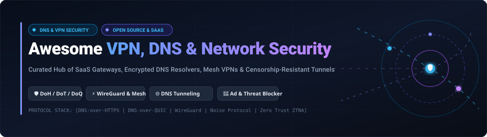

  

# 🛡️ Awesome-VPN-DNS-Network-Security

  
  
  
  
  
  

## 🌐 Top VPN, DNS & Network Security Ecosystem (Open-Source & SaaS)

> **A comprehensive, SEO-optimized curated directory of top-tier SaaS privacy platforms and open-source GitHub projects specializing in Encrypted DNS (DoH/DoT/DoQ), DNS Tunneling VPNs, Network-Wide Sinkholes, Mesh WireGuard Overlays, and Censorship-Resistant Proxy Engines.**

**Last updated: November 2026**

This repository (`Awesome-VPN-DNS-Network-Security`) tracks industry-leading **SaaS/Hosted platforms** and actively maintained **open-source repositories** designed for **VPN & DNS Network Security**. In modern security engineering, network perimeters have dissolved: modern systems combine encrypted VPN encapsulation with DNS-level threat intelligence, tunnel IP/TCP traffic inside legitimate DNS queries to bypass restrictive captive portals and deep packet inspection (DPI) firewalls, enforce DNS-over-HTTPS (DoH), DNS-over-TLS (DoT), and DNS-over-QUIC (DoQ), and deploy self-hosted recursive resolvers alongside peer-to-peer mesh overlays.

---

## 📑 Table of Contents
- [📊 Sector Overview & Market Dynamics](#-sector-overview--market-dynamics)
- [☁️ SaaS & Hosted Platforms](#️-saas--hosted-platforms)
- [💻 Open-Source GitHub Projects](#-open-source-github-projects)
- [⭐ Star History](#--star-history)
- [🤝 How to Contribute](#-how-to-contribute)
- [💖 Support & Sponsorship](#-support--sponsorship)
- [⚖️ Disclaimer](#️-disclaimer)

---

## 📊 Sector Overview & Market Dynamics

The global enterprise and consumer VPN and secure DNS market is estimated at **$54.6 Billion in 2024–2025**, projected to surpass **$135 Billion by 2032** with a compound annual growth rate (CAGR) of ~15.2%. 

The sector exhibits **moderate fragmentation with aggressive consolidation at the enterprise Zero Trust Network Access (ZTNA) tier** (led by tech giants like Cloudflare and Cisco), alongside significant rollup activity in consumer VPNs (e.g., Kape Technologies, Nord Security, Ziff Davis), while a vibrant ecosystem of specialized, privacy-audited, independent SaaS providers (Mullvad, Tailscale, NextDNS) and resilient community open-source projects thrive across decentralized mesh networking, self-hosted DNS sinkholes, and censorship-resistant tunneling.

---

## ☁️ SaaS & Hosted Platforms

The table below catalogs top SaaS and hosted platforms for VPN routing, mesh overlay tunnels, and cloud-hosted encrypted DNS security. Entries are sorted in **descending order by company valuation / market capitalization / estimated revenue**.

| Platform | Category / Focus | Pricing (Starting Tier) | Free Tier Limits | Valuation / Market Size | Official Site |
| :--- | :--- | :--- | :--- | :--- | :--- |
| **Cloudflare WARP & Gateway** | Zero Trust ZTNA / Anycast Encrypted DNS | $7.00/user/month (Gateway Zero Trust Standard) | Free forever up to 50 users (Zero Trust Free Plan; WARP client 100% free unlimited consumer data) | $35.0 Billion Market Cap (NYSE: NET) | [Visit Cloudflare](https://one.one) |
| **ExpressVPN** | Commercial Privacy VPN & RAM-only DNS | $6.67/month (12-month plan with 3 bonus months; or $12.95/month billed monthly) | No free tier; 30-day money-back guarantee with unlimited usage | $2.5 Billion Valuation (Parent: Kape Technologies) | [Visit ExpressVPN](https://expressvpn.com) |
| **NordVPN & Threat Protection** | Consumer & Enterprise VPN / Meshnet / Threat DNS | $3.09/month (2-year Basic plan; or $12.99 billed monthly) | No free tier; 30-day money-back guarantee with unlimited bandwidth (Meshnet peer-to-peer is 100% free) | $3.0 Billion Valuation (Nord Security / Nord Security unicorn round) | [Visit NordVPN](https://nordvpn.com) |
| **Surfshark & CleanWeb** | Multi-device VPN & CleanWeb DNS Ad/Malware Shield | $2.19/month (2-year starter plan; or $15.45 billed monthly) | 7-day free trial on Android/iOS/macOS (unlimited devices); 30-day money-back guarantee | $1.5 Billion Valuation (Part of Cyberspace / Nord Security Group) | [Visit Surfshark](https://surfshark.com) |
| **Tailscale** | Zero-Config WireGuard Mesh VPN & MagicDNS | $6.00/user/month (Personal Plus / Starter plan) | Free forever for personal use: 3 users, up to 100 connected devices, MagicDNS included | $1.0 Billion Valuation (Series B Unicorn) | [Visit Tailscale](https://tailscale.com) |
| **ZeroTier** | Software-Defined Virtual Ethernet Mesh Overlay | $5.00/month (Team plan starting base) | Free forever for personal use: up to 25 connected network nodes, unlimited networks | $120 Million Valuation (Private VC-backed) | [Visit ZeroTier](https://zerotier.com) |
| **Windscribe & R.O.B.E.R.T.** | Obfuscated VPN & R.O.B.E.R.T. DNS Firewall | $3.00/month (Custom Build-A-Plan starting at $1/loc + unlimited data) | Free forever plan: 10 GB bandwidth/month with access to 10 server locations and standard ad-blocking | $25 Million Annual Revenue (Bootstrapped / Private) | [Visit Windscribe](https://windscribe.com) |
| **Proton VPN & NetShield** | Swiss Privacy VPN & NetShield DNS Filtering | €4.99/month (2-year Proton VPN Plus; or €9.99 billed monthly) | Free forever plan: 1 device connection, medium speed, access to servers in 3 countries, unlimited data, no logs | $50 Million Annual Revenue (Proton AG non-profit foundation structure) | [Visit Proton VPN](https://protonvpn.com) |
| **Mullvad VPN & Mullvad DNS** | Anonymous WireGuard VPN & Encrypted DNS Blocklists | €5.00/month flat-rate (No subscriptions, pay as you go) | Free public encrypted DNS resolvers (DoH/DoT) free forever; VPN requires paid account (€5/month, no free trial) | $20 Million Annual Revenue (Amagicom AB / Privately held) | [Visit Mullvad](https://mullvad.net) |
| **Control D** | Programmable Cloud Encrypted DNS & Smart Proxy | $2.00/month (Some Filters plan; or $4.00/month Full Control plan) | Free public DNS resolvers free forever; 30-day unrestricted free trial on premium plans with full rule engine | $10 Million Estimated Valuation (Windscribe subsidiary) | [Visit Control D](https://controld.com) |
| **NextDNS** | Cloud-Hosted Customizable Encrypted DNS Firewall | $1.99/month or $19.90/year (Pro Plan with unlimited queries) | Free forever plan: up to 300,000 DNS queries/month with all security features and analytics included | $8 Million Estimated Valuation (Independent / Self-sustaining) | [Visit NextDNS](https://nextdns.io) |
| **IVPN & AntiTracker** | Independently Audited Privacy Multi-Hop VPN | $6.00/month (Standard plan; or $2.00/week option available) | No free tier; 30-day money-back guarantee with zero logs and no email registration required | $5 Million Annual Revenue (Privately held / Independent) | [Visit IVPN](https://ivpn.net) |

---

## 💻 Open-Source GitHub Projects

The following curated open-source projects power DNS-over-VPN tunneling, self-hosted recursive DNS resolvers, network-wide ad/malware sinkholes, mesh VPN overlays, and DPI-resistant proxy transports.

Entries are sorted in **descending order by GitHub stargazers count**, with dynamic social badges linked directly to each repository's stargazers page.

| Repository & Stargazers | Primary Language | Description & Key Capabilities |
| :--- | :---: | :--- |
| **[Pi-hole](https://github.com/pi-hole/pi-hole)**  | Shell / C | Industry-standard open-source network-wide DNS ad, tracker, and malware sinkhole designed to integrate with WireGuard and OpenVPN gateways. |
| **[Headscale](https://github.com/juanfont/headscale)**  | Go | Fully open-source, self-hosted implementation of the Tailscale coordination server providing private mesh overlays and MagicDNS split routing. |
| **[Xray-core](https://github.com/XTLS/Xray-core)**  | Go | Next-generation superset of V2Ray featuring advanced XTLS-Reality camouflage, transparent DNS routing, and censorship-resistant VPN tunneling. |
| **[sing-box](https://github.com/SagerNet/sing-box)**  | Go | The universal proxy and VPN platform with built-in rule-based DNS client, DoH/DoQ/fake-IP handling, WireGuard, ShadowTLS, and Hysteria2. |
| **[AdGuard Home](https://github.com/AdguardTeam/AdGuardHome)**  | Go | Network-wide DNS sinkhole and recursive resolver supporting DoH, DoT, DoQ, DNSCrypt, and granular per-client access control. |
| **[NetBird](https://github.com/netbirdio/netbird)**  | Go | Zero-configuration peer-to-peer mesh VPN platform built on WireGuard with integrated private DNS management and SSO identity integration. |
| **[Algo VPN](https://github.com/trailofbits/algo)**  | Python / Ansible | Automated deployment scripts for setting up personal, secure WireGuard and IPsec VPN servers in the cloud with local DNS encryption. |
| **[wg-easy](https://github.com/wg-easy/wg-easy)**  | JavaScript / Docker | The easiest self-hosted WireGuard Docker container with a web-based administration UI, custom DNS server assignment, and QR code generation. |
| **[Streisand](https://github.com/StreisandEffect/streisand)**  | Ansible | Automated multi-protocol VPN setup supporting WireGuard, OpenVPN, Shadowsocks, and DNS-over-HTTPS resolvers for circumventing censorship. |
| **[cloudflared](https://github.com/cloudflare/cloudflared)**  | Go | Cloudflare Tunnel client and standalone encrypted DNS-over-HTTPS (DoH) proxy daemon for local LAN and edge networks. |
| **[AmneziaVPN](https://github.com/amnezia-vpn/amnezia-client)**  | C++ / Qt | Multi-protocol censorship-resistant VPN client implementing obfuscated WireGuard (AmneziaWG), OpenVPN over Cloak, and self-hosted DNS. |
| **[CoreDNS](https://github.com/coredns/coredns)**  | Go | CNCF-graduated authoritative and recursive DNS server with modular plugin architecture for Kubernetes, DoT/DoH, and internal mesh networks. |
| **[dnscrypt-proxy](https://github.com/DNSCrypt/dnscrypt-proxy)**  | Go | Flexible DNS proxy supporting DNSCrypt v2, DNS-over-HTTPS (DoH), Anonymized DNS relays, DNSSEC validation, and local query filtering. |
| **[Netmaker](https://github.com/gravitl/netmaker)**  | Go | High-performance automated WireGuard virtual networking platform for cross-cloud clusters with embedded private CoreDNS resolution. |
| **[wireguard-install](https://github.com/angristan/wireguard-install)**  | Shell | Battle-tested shell script to configure and deploy a production WireGuard VPN server on Debian/Ubuntu/CentOS with customized DNS resolvers. |
| **[shadowsocks-rust](https://github.com/shadowsocks/shadowsocks-rust)**  | Rust | High-performance, memory-safe Shadowsocks implementation with integrated DNS caching, DoH client, and traffic obfuscation plugins. |
| **[Technitium DNS Server](https://github.com/TechnitiumSoftware/DnsServer)**  | C# | Self-hosted authoritative & recursive DNS server with web console, DNSSEC, DoH/DoT/DoQ, threat blocklists, and advanced split routing. |
| **[Firezone](https://github.com/firezone/firezone)**  | Rust / Elixir | Zero Trust Network Access (ZTNA) platform built on WireGuard with granular DNS-based resource routing and identity provider integration. |
| **[iodine](https://github.com/yarrick/iodine)**  | C | Foundational IP-over-DNS tunneling tool that encapsulates full IPv4 network traffic inside standard DNS queries/responses across port 53. |
| **[Mullvad VPN App](https://github.com/mullvad/mullvadvpn-app)**  | Rust / Electron | Official open-source desktop and mobile client for Mullvad VPN with WireGuard, DAITA defense against AI traffic analysis, and custom DNS. |
| **[MasterDnsVPN](https://github.com/masterking32/MasterDnsVPN)**  | Python | Asynchronous multi-threaded DNS tunnel VPN with SOCKS5 proxy support, multi-resolver load balancing, and MTU optimization for restricted WANs. |
| **[Blocky](https://github.com/0xERR0R/blocky)**  | Go | Fast, lightweight DNS proxy and ad-blocker for local networks written in Go with DoH/DoT upstream support, Prometheus metrics, and Redis cache. |
| **[RethinkDNS](https://github.com/celzero/rethink-app)**  | Kotlin / Go | On-device Android firewall, WireGuard VPN client, and encrypted DNS resolver supporting DoH, DNSCrypt, and Oblivious DoH (ODoH). |
| **[Unbound](https://github.com/NLnetLabs/unbound)**  | C | High-performance validating, recursive, and caching DNS resolver supporting DNSSEC validation, DNS-over-TLS (DoT), and strict privacy controls. |
| **[OPNsense Core](https://github.com/opnsense/core)**  | PHP / Python | Open-source firewall and routing platform with native Unbound DNS, WireGuard/OpenVPN services, DNSBL blocklists, and intrusion prevention. |
| **[dnscat2](https://github.com/iagox86/dnscat2)**  | C / Ruby | Encrypted command-and-control (C2) and TCP port forwarder designed to create authenticated communication tunnels entirely through standard DNS. |
| **[WireGuard Linux](https://github.com/WireGuard/wireguard-linux)**  | C | The official kernel module source for WireGuard, delivering ultra-fast cryptographic network tunneling directly in the Linux kernel. |
| **[personalDNSfilter](https://github.com/IngoZenz/personaldnsfilter)**  | Java | Lightweight, versatile DNS filter proxy running on local devices and VPN interfaces to filter ads, tracking, and malware with DoH/DoT support. |
| **[dns2tcp](https://github.com/alex-sector/dns2tcp)**  | C | Classic network utility for relaying arbitrary TCP connections (such as SSH tunnels) over DNS TXT queries without requiring TUN/TAP devices. |
| **[dnstt](https://github.com/Mygod/dnstt)**  | Go | Censorship-resistant DNS tunnel utilizing DNS-over-HTTPS (DoH) and DNS-over-TLS (DoT) with Noise protocol encryption and KCP packet multiplexing. |

---

## 📈 Star History

---

## 🤝 How to Contribute

Contributions to expand and refine this ecosystem directory are warmly welcomed!
1. **Fork** this repository.
2. Create a branch (`git checkout -b add-awesome-tool`).
3. Add the project in alphabetical or star-ranked order with accurate, factual descriptions and official URLs.
4. Ensure entries follow standard Markdown table formatting.
5. Submit a **Pull Request** detailing why the tool is beneficial to network security practitioners.

---

## 💖 Support & Sponsorship

If you found this curated list helpful for your network infrastructure, privacy research, or self-hosted deployment:
- ⭐ **Star** this repository to show your appreciation and help others discover it!
- 🍴 **Fork** and share it with fellow sysadmins, cybersecurity engineers, and homelab enthusiasts.
- ☕ **Sponsor or Buy Me a Coffee**: Support ongoing maintenance and curation via the [GitHub Sponsor Dashboard](https://github.com/sponsors/ishandutta2007).

---

## ⚖️ Disclaimer

*This list is provided for educational, research, and defensive security engineering purposes only. Please verify local laws, acceptable use policies, and compliance obligations before deploying tunneling protocols or intercepting network traffic on corporate or public infrastructures.*
